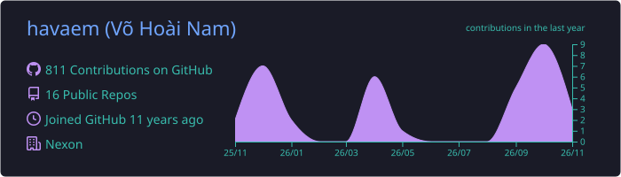
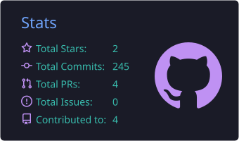
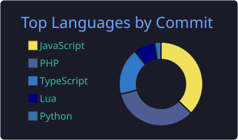

<!-- Header -->

  

  

  
  

<h2 align="left">🤡 ABOUT ME</h2>

- 🌏 Web Developer from **Viet Nam**
- ✨ Creating bugs since **2019**
- 📚 Currently learning everything from the world
- 🎲 Fun fact: Luck is not my friend

<h2 align="left">🛠️ TECHNOLOGIES</h2>

  

<h2 align="left">📊 GITHUB STATS</h2>

  

  
  

  

<h2 align="left">🌐 SOCIAL NETWORK</h2>

  
  
  

###

<h2 align="left">OTHER</h2>

###

  <picture>
  <source media="(prefers-color-scheme: dark)" srcset="https://raw.githubusercontent.com/havaem/havaem/output/github-contribution-grid-snake-dark.svg" />
  <source media="(prefers-color-scheme: light)" srcset="https://raw.githubusercontent.com/havaem/havaem/output/github-contribution-grid-snake.svg" />
  
</picture>

###

  

